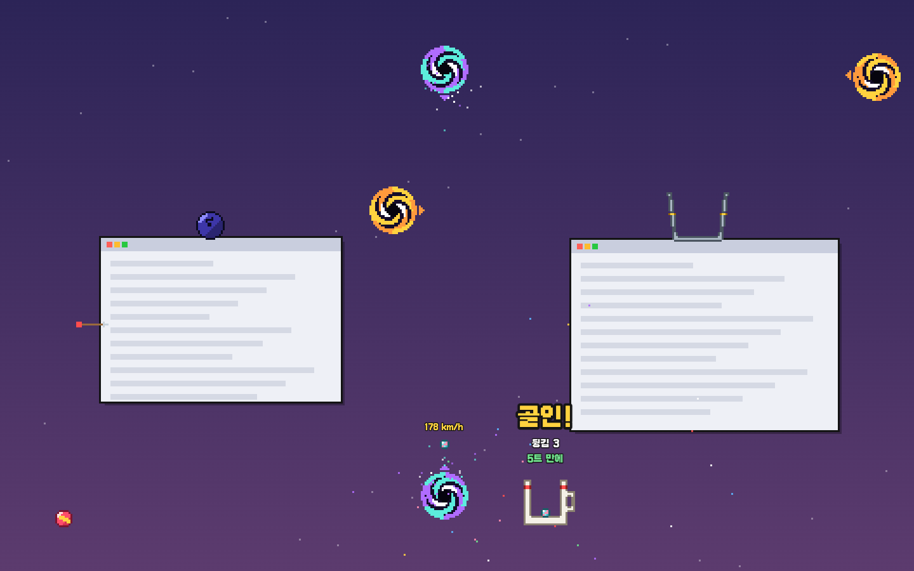

# 🌀 웜홀 모니터

바탕화면에 **웜홀**을 뚫고 구슬·화살·볼링공을 던지고 쏘며 노는 도트 장난감.
웜홀은 두 개가 한 쌍으로 이어지고(개수 제한 없음, 양방향), 물건은 중력을 받아 날아가요.
화살은 **다른 앱 창에 박히고**, 볼링공을 떨어뜨리면 **창이 조금씩 눌려 내려가고**, 폭탄은 창들을 밀어내요.
판자·범퍼·컵 같은 구조물을 놓거나 선을 그려서 구슬을 이리저리 튕겨 **컵에 골인**시키면, 그 장면이 세로 영상으로 저장돼요.
마우스 커서도 웜홀에 들어가면 반대쪽으로 나와요.

## 다운로드

- 맥 13 이상 (애플 실리콘·인텔, 애플 공증): [WormholeMonitor-mac.dmg](https://github.com/kanchoooo/wormhole-monitor/releases/latest/download/WormholeMonitor-mac.dmg)
- 윈도우 10/11: [WormholeMonitor-Setup.exe](https://github.com/kanchoooo/wormhole-monitor/releases/latest/download/WormholeMonitor-Setup.exe) — "Windows의 PC 보호" 창이 뜨면 **추가 정보 → 실행**
- 다운로드 페이지: https://kanchoooo.github.io/wormhole-monitor/



- 맥 / 윈도우 (Electron 44 + TypeScript, 프레임워크 없음)
- 물리: [Rapier 2D](https://rapier.rs) (결정적 빌드 — 같은 코스·같은 힘이면 같은 결과). 모든 화면을 하나의 좌표로 묶어 메인 프로세스에서 계산 (`src/main/engine/world.ts`)
- 그림: 이미지 파일 없이 도트 칸마다 색을 계산해서 그림 — 어느 각도·도트 크기에서도 도트 느낌 (`src/renderer/src/art/dots.ts`)
- 효과음: WebAudio 합성 (`src/renderer/src/common/sound.ts`)
- 다른 앱 창 읽기·옮기기·커서 이동: [koffi](https://koffi.dev) FFI — 맥은 CoreGraphics + 손쉬운 사용(AX), 윈도우는 user32/dwmapi (`src/main/windows/`)
- 앱 아이콘·홍보 그림: Codex 이미지 생성 (`scripts/codex-image.sh`, 원본·프롬프트는 `art-src/`)

## 실행

```bash
npm install
node scripts/fetch-koffi.mjs   # 맥 x64/arm64 · 윈도우용 koffi 네이티브 모듈 (패키징 때만 필요)
npm run dev                    # 개발 모드 (메뉴 막대/트레이에 웜홀 아이콘, 공구함이 뜸)
npm test                       # 물리 확인 (골인·무한 낙하·창 누르기·화살 박힘·코스 코드)
```

공구함을 닫아도 메뉴 막대(맥) / 트레이(윈도우)의 웜홀 아이콘으로 계속 실행돼요. 완전히 끄려면 트레이 메뉴 → 종료.
공구함 아래·트레이 메뉴에 **개발자의 다른 앱 보기**(easyticket.co.kr/apps)와 인스타그램 링크가 있어요.

## 놀이

| 도구 | 하는 일 |
|---|---|
| 🖱 손 놓기 (ESC) | 도구를 내려놓고 화면을 그대로 써요. 놓은 것들은 그대로 남아 계속 움직여요 |
| 🌀 웜홀 | 클릭 두 번 = 한 쌍. **밖에서 안으로 들어가는 것**만 빨려들고, 짝 웜홀의 **한가운데서 들어간 속도·방향 그대로** 나와요 (위아래로 놓으면 무한 낙하) |
| ✋ 손 | 장난감을 잡아 던지고, 구조물·웜홀을 옮겨요. 구조물은 노란 손잡이(또는 휠)로 15°씩 돌려요 |
| 🧽 지우개 | 문지르면 지워져요. 어느 도구든 **오른쪽 클릭 = 그 자리 것 지우기** |
| 굴릴 것 · 쏠 것 | 클릭 = 그 자리에 놓기, **당겼다 놓기 = 새총**. 웜홀을 거치는 궤적까지 점선으로 미리 보여요 (설정: 전체 / 앞만 / 끔) |
| 구조물 12종 | 판자·범퍼·스프링·깔때기·컵·양동이·농구 골대·시소·풍차·컨베이어·종·핀 판. 끌면서 놓으면 기울어져요. 📌 고정을 풀면 구조물도 떨어지고 밀려요 |
| 그리기 4재질 | 나무(보통)·고무(잘 튐)·얼음(미끄러움)·끈끈이(붙어서 멈춤). 그린 선은 벽이 돼요 |

| 장난감 | 특징 |
|---|---|
| 유리구슬 · 쇠구슬 · 탁구공 · 고무공 | 골인 놀이용. 탁구공·고무공은 잘 튀어요 |
| 볼링공 | 무거워서 창 위에 떨어지면 창이 쿵 내려가고, 올라앉아 있으면 슬금슬금 눌러요 |
| 수박 | 세게 부딪히면 깨져요 |
| 화살 · 다트 | 빠르게 맞으면 창·나무에 박혀요. 창을 옮기면 같이 따라가고, 박힌 화살 위에 구슬이 올라앉을 수 있어요 |
| 폭탄 | 2.6초 뒤 펑 — 주변 장난감과 창을 날려요 |

### 골인
구슬이 컵·양동이 안에 잠깐 머물거나 농구 골대를 위에서 통과하면 **골인!** 도장과 함께 `튕김 3 · 웜홀 1 · 2트 만에` 가 찍혀요.
웜홀 무한 낙하는 속도계가 뜨고 최고 약 990 km/h 까지 빨라져요.

### 코스
- **도전 코스 8개**: 첫 골인 · 웜홀 한 번 · 범퍼 핀볼 · 플링코 · 농구 · 무한 낙하 탈출 · 택배 배달 · 웜홀 콤보
- **📋 내 코스 복사** → `WH1.…` 코드가 클립보드에. 친구가 **📥 코드 붙여넣기** 하면 같은 코스가 깔려요 (화면 크기가 달라도 비율로 맞춤, 장난감·창은 빼고)

### 영상 (두 가지)
- **도트 영상** (권한 필요 없음): 골인하면 던진 순간부터 골인 2.5초 뒤까지를 1080×1920 세로 영상으로 다시 그려 저장. 처음엔 코스 전체 → 구슬을 따라 확대 → 골인 직전 슬로모션. 창은 단순한 상자로 그려서 **내 화면 내용은 담기지 않아요**.
- **실화면 영상** (🎥 실화면 녹화, ⌃⌥R): 실제 화면을 세로로 잘라 녹화 (움직이는 쪽을 따라감). 공구함은 찍히지 않아요. 멈추면(기본: 골인 2초 뒤 자동) 같은 장면의 도트 영상도 같이 저장.
- 저장 위치: `~/Movies/웜홀 모니터/웜홀-<날짜-시각>-도트.mp4`, `…-화면.mp4` (윈도우는 `동영상\웜홀 모니터`)

### 실제 창
- 화면에 보이는 창(30% 이상 보이는 창)이 물리 상자가 돼요. 최대화·전체화면 창과 메뉴 막대·Dock은 건드리지 않아요.
- 창은 무중력 + 마찰이 있어서 구슬 몇 개는 버티고, 볼링공·폭탄·빠른 공에 밀려요. 화면 밖으로는 나가지 않아요.
- 직접 창을 끌면 창이 공을 밀어내요(방망이처럼). 다 놓으면 다시 물리로.
- **🪟 창 원위치**: 밀려난 창을 처음 자리로 한 번에.
- 맥: 처음에 **손쉬운 사용** 권한을 켜야 창이 움직여요 (공구함 › 권한 켜기). 권한이 없으면 창은 부딪히기만 하고 움직이지 않아요.
- 윈도우: 권한 필요 없음. 관리자 권한으로 실행된 창은 옮길 수 없어요.

## 단축키

| 키 | 동작 |
|---|---|
| ⌃⌥W (Ctrl+Alt+W) | 공구함 열기/숨기기 |
| ⌃⌥R (Ctrl+Alt+R) | 실화면 녹화 시작/멈춤 |
| ⌃⌥H (Ctrl+Alt+H, 공구함 › 설정에서 바꿀 수 있음) | **모두 숨기기** — 놓은 것·장난감·공구함을 그 상태 그대로 멈춰서 숨김, 한 번 더 누르면 그대로 다시 (공구함 🙈 버튼·트레이 메뉴도 같음) |
| ESC | 도구 내려놓기 (도구를 쓰는 동안만 잡음) |
| ⌘Z / Ctrl+Z | 되돌리기 (도구를 쓰는 동안만) |

## 배포

| 명령 | 하는 일 |
|---|---|
| `npm run dist:mac` | 맥 유니버설 dmg + zip, Developer ID 서명 + 공증 + 검사 (`dist/WormholeMonitor-mac.dmg`) |
| `npm run verify:mac` | 이미 만든 빌드의 서명·체인·공증·스테이플 검사만 |
| `npm run dist:mac:local` | 서명 없이 내 맥용 .app |
| `npm run dist:win` | 윈도우 설치 파일 (맥에서도 빌드됨, 서명 없음) |
| `npm run release` | 버전 올리고 GitHub Releases 에 맥·윈도우 올려 공개 (자동 업데이트) |

### 맥 서명·공증·인증서 체인
- 서명은 비둘기 모니터·미니미 광장과 같은 **Developer ID 인증서**(`~/.minimi-signing/`, 원본 — 사본은 `~/작업장/키보관함/맥_서명인증서/`), 공증은 키체인 프로필 `minimi-notary`.
- 이 인증서는 **Developer ID Certification Authority G2** 가 발급했는데 맥 키체인에는 옛 G1 중간 인증서(2027-02-01 만료)만 있었다.
  그래서 애플 공개 G2 중간 인증서를 `build/certs/DeveloperIDG2CA.cer` 로 저장소에 두고(SHA256 `f16cd3c5…df3a`, Apple Root CA 로 검증),
  빌드 때 임시 키체인에 같이 넣어 **Developer ID Application → Developer ID CA (G2) → Apple Root CA** 체인을 다 갖춘다.
- `scripts/build-mac.mjs`: 미니미 광장과 같은 잠금(`~/.minimi-signing/.build.lock`)으로 서명 빌드를 하나씩만 돌리고, 임시 키체인(`wormhole-build.keychain-db`)은 검색 목록 맨 뒤에만 붙였다가 끝나면(실패·Ctrl+C 포함) 빼고 지운다.
  앱은 electron-builder 가 공증하고, **dmg 도 서명 → 공증 → 스테이플** 한 뒤 `latest-mac.yml` 의 dmg 해시를 고친다.
- `scripts/verify-mac.mjs` (빌드 끝에 자동): deep·strict 서명 검증, Authority 3단계, 팀 ID, 타임스탬프, 하드닝 런타임, 발급자 = G2, Gatekeeper(`source=Notarized Developer ID`) 앱·dmg, 스테이플 앱·dmg. 하나라도 어긋나면 실패 → 릴리스에 안 올라감.
- 손쉬운 사용 권한은 서명(팀 ID + 번들 ID `com.wormholemonitor.app`)에 묶이므로, 같은 인증서로 서명한 업데이트는 권한이 유지된다. 서명 없는 개발 빌드는 권한을 따로 받아야 한다.
- 윈도우는 서명 없이 배포. 태그가 올라가면 `.github/workflows/release.yml` 이 설치 파일을 만든다.

## 테스트·자동 조작

```bash
npm test                                            # 물리 단위 확인 (Electron 없이)
WH_HEADLESS=1 WH_SCRIPT=장면.json WH_SHOT_DIR=out npx electron .   # 화면 없이 장면을 돌리고 캡처 (가짜 창만 씀)
WH_SELFTEST=1 npx electron .                        # 창 목록·옮기기 권한 확인 (패키징 확인용)
```

`WH_SCRIPT` 동작: `tool` · `down`/`move`/`up` · `drag` · `spawn` · `portal` · `struct` · `stroke` · `challenge` · `windows`(가짜 창) · `shot` · `quit` (`src/main/engine/script.ts`).
헤드리스에서는 **진짜 창을 절대 건드리지 않는다** (가짜 창 목록만 씀).

## 저작권

글꼴: [Galmuri](https://github.com/quiple/galmuri) (SIL OFL 1.1, `src/renderer/src/assets/fonts/ofl.md`). 물리: Rapier (Apache-2.0).
